<div align="center">

<h1>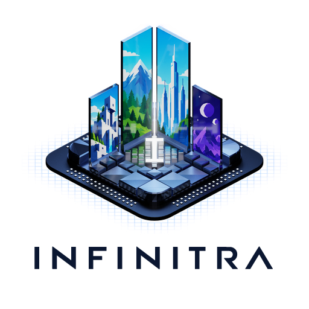</h1>

**Dare to Explore a Universe Born from Mathematics.**

<a href="https://www.youtube.com/@InfinitraWorld">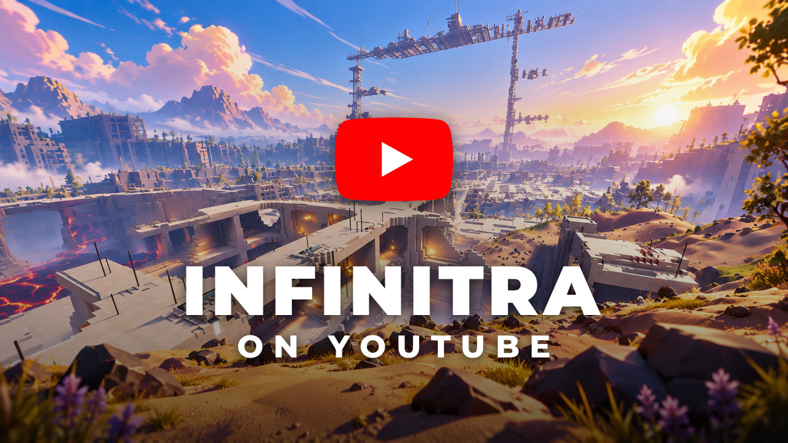</a>

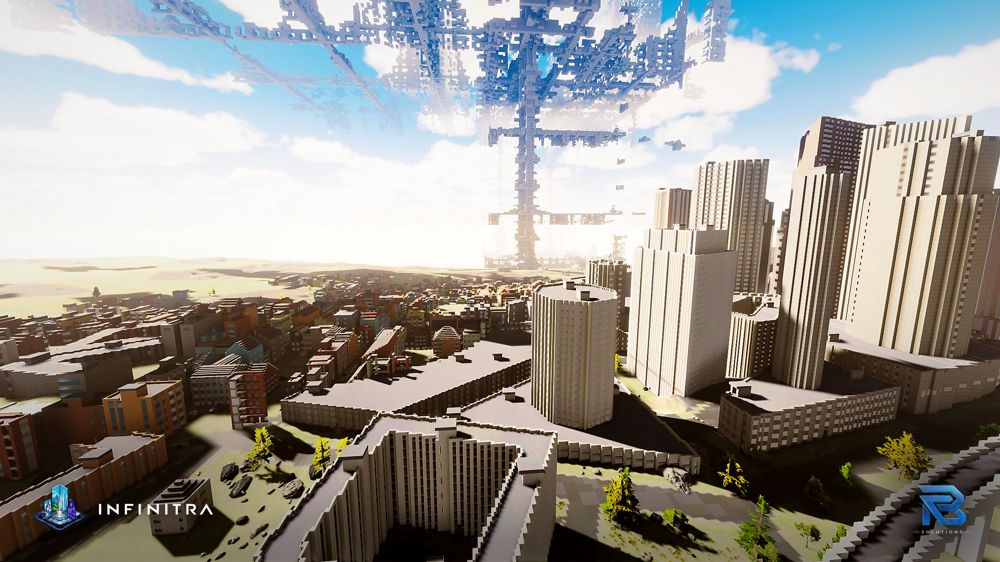
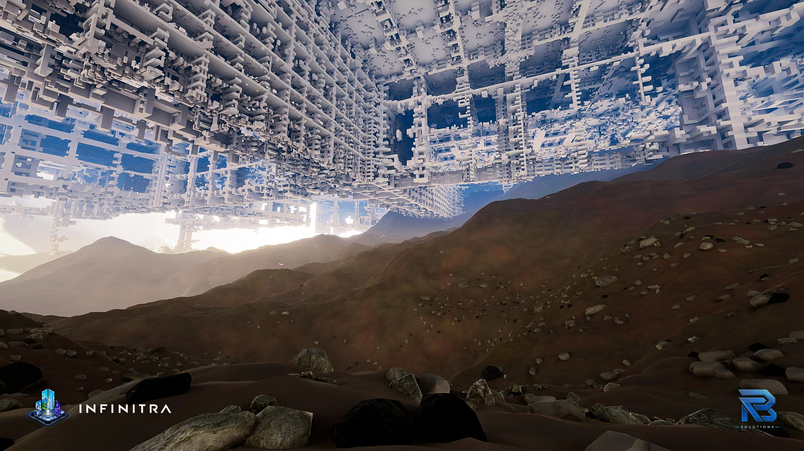
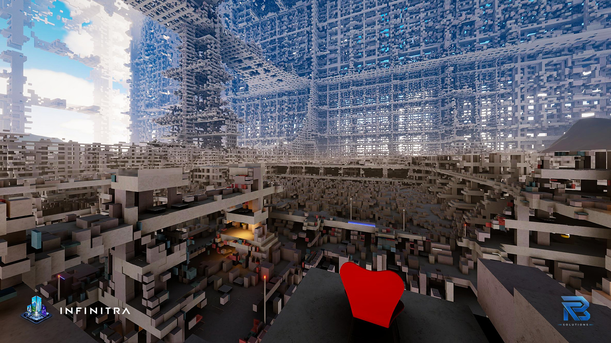
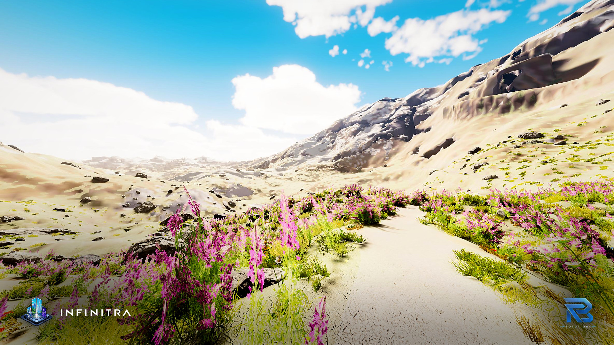
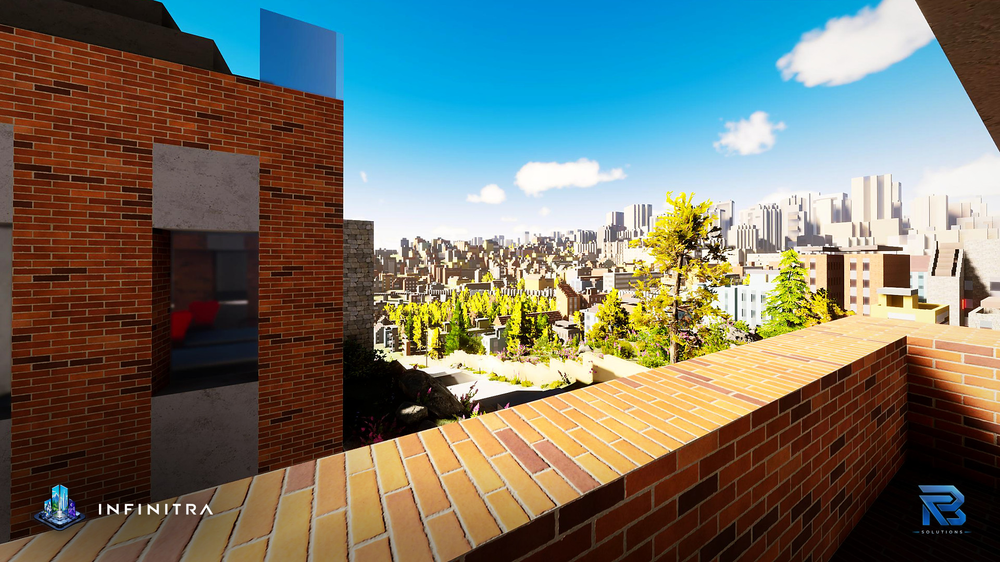
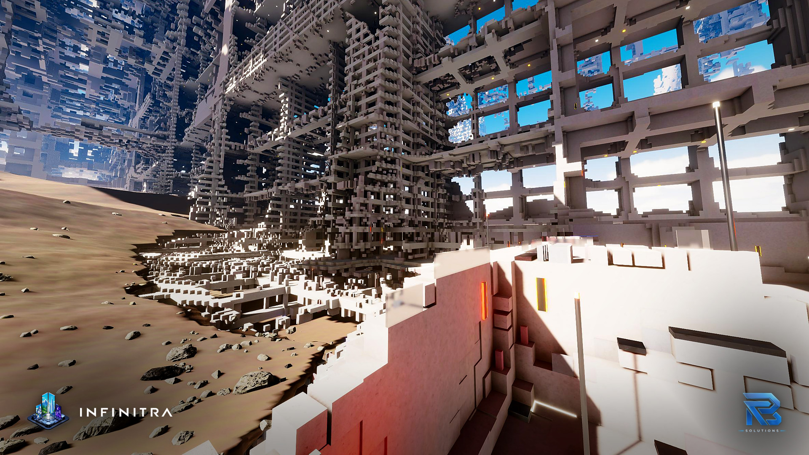
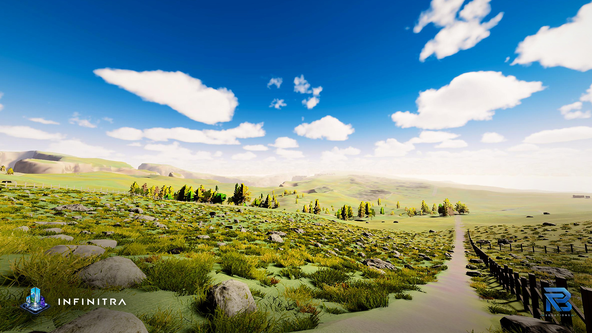
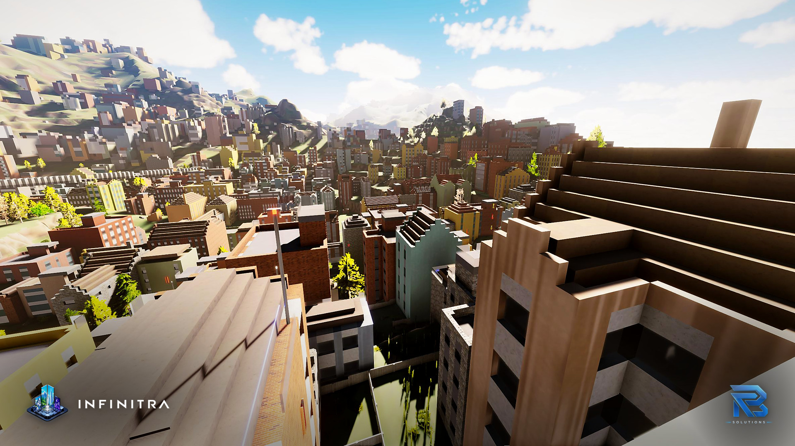
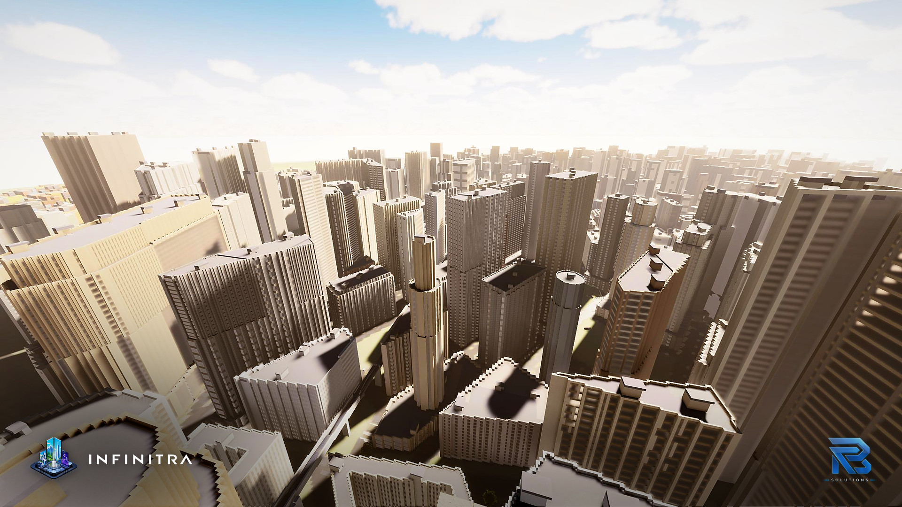
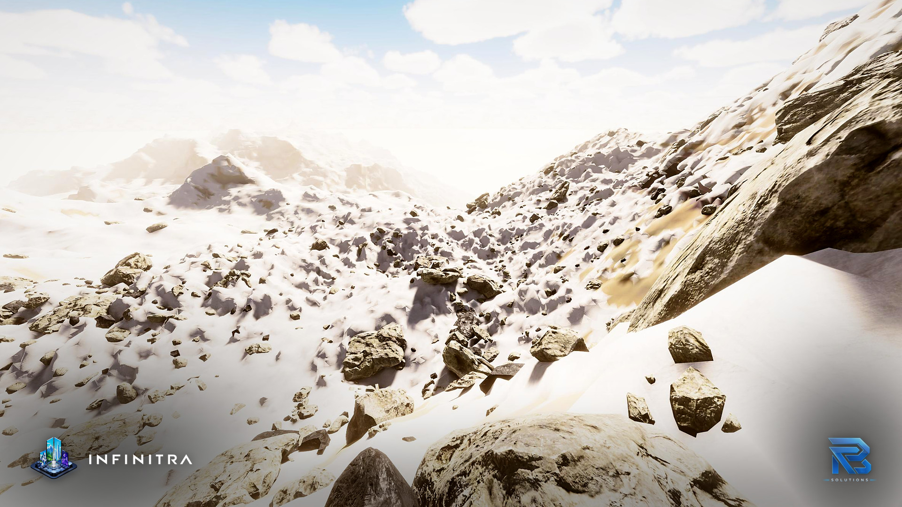

[](https://github.com/richardbogad/INFINITRA/releases/)
[](https://github.com/richardbogad/INFINITRA/issues)
[](https://github.com/richardbogad/INFINITRA/discussions)

</div>

## Table of Contents

- [What INFINITRA Is](#what-infinitra-is)
- [A New Way to Build a World](#a-new-way-to-build-a-world)
- [What You Do Out There](#what-you-do-out-there)
- [Download and First Launch](#download-and-first-launch)
- [Controls](#controls)
- [Field Manual](#field-manual)
- [Accounts and Subscription](#accounts-and-subscription)
- [The Future of INFINITRA](#the-future-of-infinitra)
- [System Requirements](#system-requirements)
- [Legal and Licensing](#legal-and-licensing)

---

## What INFINITRA Is

A shared universe for Windows, played on your monitor or in a VR headset connected to your PC. It spans **10 trillion kilometres**, and it is computed from mathematics instead of drawn by hand.

It is **free to download** and runs **with no account at all**. A subscription adds the parts that persist and are shared, and pays for the servers. INFINITRA is in Early Access and developed in the open; [**Dev Progress**](https://www.infinitra.xyz/docs/dev/PROGRESS.html) shows how it was built, month by month.

Pick a direction. See what is out there.

---

## A New Way to Build a World

Decades of progress in computing, and game worlds are still drawn by hand. Every valley, every corridor and every room is placed by somebody, and the data grows with the cube of the radius: double the reach and there is eight times as much to store. The biggest worlds now ship as hundreds of gigabytes, and they still end at a fence.

Procedural generation was supposed to be the way out, and it has barely moved. At design time it bakes a large static map, which is then shipped like any other map and meets the same wall. If used in real time it has to keep up with the frame, so it stays confined to simple calculations. The result is either a world too plain to be worth exploring, or a pseudo infinite one, a scattering of small separate planets loaded into memory one at a time.

INFINITRA removes that wall with calculation methods developed for this problem alone. The world is one continuous mathematical definition, asked what exists at any point in space, at any scale, and asked only where you are, only at the detail you can actually see. That frees the calculation behind a place to be as complex as the place deserves, at any size. Landscape, caves, city, the rooms inside the towers and the structures hanging in the sky all come out of that one definition. No tile to repeat, no seam to hide, no boundary to cross.

What that makes possible:

- **Solid, not a surface.** Caves, shafts, overhangs, canyons between facades and furnished interiors exist because the world is defined as a volume, not as a landscape with decoration laid on it.
- **Detail arrives as you approach.** What is near is computed finely, what is far coarsely, and neighbouring regions meet exactly on the plane between them. Coming closer adds detail rather than exchanging the world for a different one.
- **Nothing is stored, so nothing runs out.** A place nobody has visited holds no data anywhere. It is computed the moment you arrive, and it comes out the same for everyone who ever goes there.
- **The world remembers only what people did to it.** Carve a cavity and that is kept and shared with everybody. Everything else is mathematics, and mathematics costs nothing to keep.

---

## What You Do Out There

You **explore, survive and collect.**

Travel costs battery charge, by the kilometre and by the mass of the body you wear. Height costs health, and some ground, lava among it, burns while you stand in it. Different kinds of items lie in the world: they heal you, recharge you, allow you to fly, put your position and bearing on screen, save a place you want to return to, or cut a cavity out of the world itself.

In multiplayer mode, what you carve is carved for everybody, what you pick up is gone for everybody, and what you drop waits for whoever finds it.

And around all of that:

- **No zones, no borders.** Walk out of open landscape into a lit interior and out again without an interruption.
- **Furnished, not empty.** The same mathematics that shapes the world also fills it: plants and trees, street furniture, the contents of rooms, and the items you can pick up and use in a world you share with others.
- **A sky that moves.** A full day runs in **thirty minutes**: a travelling sun, volumetric cloud, haze and a genuinely dark night, with an *Always Daytime* switch for anyone who wants permanent daylight.
- **You can hear where you are.** Reverberation measured from the real shape of the space around you, wind that rises with speed and openness, footsteps that change with the ground, and spatial sound for items and explorers.
- **Walk, climb, crouch and fly.** Step climbing and slopes on the ground, free flight in every direction from the drone body or from a jetpack found in the world. Entering flight cancels a fall, so a jetpack triggered halfway down a drop saves you.
- **Headset and monitor as equals.** Put the headset on and the product switches to it. Movement as teleport or continuous, turning as snap or smooth, on the hand you choose.
- **It works out your machine.** Detail tunes itself to keep a healthy frame rate, and never overrides a setting you chose yourself.
- **No store, no account, no tracking.** A free download from our own releases page, playable offline without registering, and a published commitment to collect nothing for advertising or behavioural analytics.

---

## Download and First Launch

[**Download INFINITRA**](https://github.com/richardbogad/INFINITRA/releases), then double click the `.exe`, or extract the `.zip` and run `infinitra.exe`.

**Check it before you run it.** Beside every release file is a `.sha256` file holding that file's digest. From the folder you downloaded into, in PowerShell:

```powershell
Get-FileHash .\Infinitra_*.zip -Algorithm SHA256
```

The hash it prints must match the contents of the `.sha256` file. If it does not, the file is damaged or was altered on the way, so download it again.

The executables and the INFINITRA DLLs are signed through **Microsoft Azure Trusted Signing**, with a trusted timestamp, so Windows can tell who built them and that nothing has changed since. Right click a file, open **Properties** and its **Digital Signatures** tab, or run:

```powershell
Get-AuthenticodeSignature .\infinitra.exe | Format-List Status, SignerCertificate
```

`Status` reads `Valid`, and the certificate names Richard Bogad Solutions.

Once per machine, the first launch shows a photosensitive seizure warning and the EULA in full, and asks you to confirm your age, because INFINITRA is for adults. The Terms, the EULA and the Privacy Policy stay reachable from the in game **Help** screen at any time.

Then the loading screen counts *calculating surroundings* as a percentage, and play begins as soon as enough of your surroundings exist, not once all of them do. Press `Escape` for the main menu. Without an account you are exploring offline, and nothing is stored.

---

## Controls

| Action | Keyboard and mouse | Controller |
|:---|:---|:---|
| **Move** | `W` `A` `S` `D` (arrow keys also work) | Thumbstick, movement hand |
| **Look / Turn** | Mouse | Thumbstick, other hand |
| **Jump / Up** | `Spacebar` | Top button, other hand |
| **Crouch / Down** | `Alt` (either one) | Bottom button, other hand |
| **Collect Item** | `C` | Point at it and squeeze the grip |
| **Activate Item** | `Tab` | Point at it and pull the trigger |
| **Inventory** | `V` | Top button, movement hand |
| **Item Information** | `I` | Bottom button, movement hand |
| **Main Menu** | `Escape` | Menu button, either controller |

Invert the vertical axis and set the mouse sensitivity in the main menu, under *Settings*, on the **Mouse & Keyboard** screen. The nearest item you are looking at is marked and says what it offers: *"Press C to collect"*, *"TAB to activate"*, *"I for info"*.

### In the Headset

Put the headset on and the product switches to it; take it off and it switches back. Three independent signals decide whether a head is really wearing it, so a headset resting on a desk does not keep you in VR. The **VR** screen, beside *Mouse & Keyboard*, holds three comfort choices:

- **Movement Mode**: continuous or teleport. In teleport mode you push the movement stick to aim and release to travel.
- **Turning Mode**: continuous or snap.
- **Movement Hand**: left or right. Turning goes to the other hand, and the menu button works on both controllers.

On Meta Quest Touch controllers the top buttons are **B** and **Y**, the bottom ones **A** and **X**.

> **Tip:** register and sign in on the desktop before you put the headset on. Text entry in a headset connected to a PC depends on what your platform offers for it.

---

## Field Manual

### Two Bodies

You pick one of two avatars on the **Character** screen in the main menu. The choice is not cosmetic: the two bodies move, sound, endure and travel differently, and only the drone flies without an item.

| | **Walker** | **Drone** |
|:---|:---|:---|
| Mass | 150 kg | 400 kg |
| Battery | 100 kWh | 200 kWh |
| Shrugs off a fall of about | 5 m | 15 m |
| Destroyed from full health at about | 45 m | 75 m |
| Flight | jetpack item only | built in, always |
| Character | footsteps, animation, crouch | two engine loops |

Travel costs **0.02 kWh per kilogram per kilometre**, roughly 33 km on a full walker charge and 25 km on a drone's. Your display name is drawn from two curated lists of fifty words, about 2,500 combinations; nobody types a name. Changing body needs a subscription.

### Staying Alive

- **Health** is lost when your body absorbs more impact than it can take. Falls are measured from where ground contact was lost, so stairs and stumbles do not register.
- **Energy** drains with distance and mass. An empty battery cuts you to quarter speed and costs 50 health per hour until the body dies. Teleporting and reconnecting cost nothing.
- **Harmful ground** such as lava drains you while you stand in it, billed against your body's tolerance.
- **The bars** in the corner are health (heart) and energy (bolt), shown against the capacity of the body you wear.
- **Dying** fades the world to black and asks you to choose a saved location to return to, at full health. What you carried drops where you fell and stays there, for you or for whoever finds it first.
- **A dropped connection** does not end your session: play continues locally, and what you spent is settled when the connection returns.

### Things You Can Find

Items lie scattered through the world, some common, some rare. Some heal, some refill your energy, some carry you into the air, some help you find your way and keep the places you found, and one kind opens the world itself. What a particular item does, and whether it can be collected or activated, is written in its own information panel: focus it and press `I`.

Picking an item up and using it are part of **multiplayer mode**, so they need an account with a subscription. The contents of the world are then genuinely shared: what you take is missing for everybody else too; what you drop lies where it fell for whoever comes next; and world geometry you change is changed for others. The world has no end, but it is one world, and everyone who passes that place sees what you did to it.

### Inventory, Locations and Travel

Press `V` for the inventory, with a rotating preview per row and the choice to activate, deactivate, drop it back into the world or destroy it.

The **Locations** screen holds numbered slots, each with the date it was saved and a readable coordinate and compass description, with *Store*, *Delete* and *Teleport* beside it. Everyone starts with one place: *Random spawn close to origin*.

**Teleport** moves you instantly to a saved slot or to a random spot in the starting area. Random destinations within the starting area are open to everybody; a saved slot needs a subscription. Sign in again and you are put back where you were, on any machine and in either mode.

### Other Explorers

Explorers in your area appear in real time with their body, their display name above them, the animation and sounds of what they are doing. Seeing others, and being seen by them, is a subscriber capability. Activate the *Gps & Compass* and read your position out: that is how explorers tell each other where to meet.

### Settings and Performance

The **Visuals** screen, in the main menu under *Settings*:

| Setting | Options |
|:---|:---|
| **Visual Range**, how far you can see | Auto, Minimum, Low, Medium, High, Ultra |
| **Visual Quality** | Auto, Minimum, Low, Medium, High, Ultra |
| **Object Density**, how much of the world's furniture is drawn | Auto, Minimum, Low, Medium, High, Ultra |
| **Always Daytime** | on / off |
| **Display Mode** | Window, Borderless, Fullscreen |
| **Frame Rate** | V-Sync, 30, 60, 120, Unlimited |

On *Auto* the product aims for a healthy frame rate and adjusts the detail itself as you travel. **Anything you set explicitly is left alone**, and your settings are kept on that machine between sessions.

### Messages, Help and Updates

Short messages appear in the corner and clear themselves: they confirm (*"Item collected."*), refuse with the reason (*"Not enough inventory space."*), and report the connection state. **Help** in the main menu opens the legal documents, the project page, the discussion board and *Report an Issue*. An out of date copy shows an *UPDATE REQUIRED* screen with a download button.

---

## Accounts and Subscription

Accounts and subscriptions are handled **inside the INFINITRA software**. An account needs a verified email address and may only be created from the age of 18.

| | **Guest** (no account) | **Registered** (free) | **Subscriber** |
|:---|:-----------------------|:----------------------|:---------------|
| The whole world, all movement, flight, the day cycle, sound, hazards, health and energy, settings | yes                    | yes                   | yes            |
| Teleport to coordinates or to a random spot in the starting area | yes                    | yes                   | yes            |
| Your last position saved and restored, on any machine | no                     | yes                   | yes            |
| Collect and use items | no                     | no                    | yes            |
| Inventory slots | no                     | no                    | yes            |
| Saved location slots | no                     | no                    | yes            |
| See other explorers, and be seen by them | no                     | no                    | yes            |
| Change your character | no                     | no                    | yes            |

**Traveler Extensions, 3.99$ / month.** Its five benefits, in the product's own words: *Multiplayer (see other users), Change your Avatar, Item Pickup and Usage, usable Location Slots, usable Inventory Slots.* A subscription is also what pays for the servers and for the work that keeps going into this.

- **Buying and managing it:** the *Account* screen opens our payment partner in your browser, and afterwards the same button becomes *Manage* and opens the partner's own portal, with your invoices and the cancel button. Some features take a few minutes to become active.
- **The terms:** billed monthly in advance, renewing automatically until you cancel. There is no trial period. You can play without an account for as long as you like, and see both the world and how it runs on your machine, before you decide. See the [Terms of Service](TERMS.md).
- **Your position is kept in its own record**, so the place you reached survives the end of a subscription and is restored if you come back.
- **Deleting your account** is in the product, behind a confirmation that states plainly what goes. See the [Privacy Policy](PRIVACY.md) for your other data protection rights.

---

## The Future of INFINITRA

Nobody has run a complex world of this size with people living in it, so what it becomes is partly your call. The [**Discussions**](https://github.com/richardbogad/INFINITRA/discussions) board is open to everyone: feature requests, ideas and arguments are welcome there, and they shape what gets built next. Anything broken or strange goes to *Report an Issue* in the Help screen or straight to the [**Issues**](https://github.com/richardbogad/INFINITRA/issues) tracker, with a screenshot if you can.

**Planned**

- **Building, and not only carving.** The Carver already removes matter permanently and shares the result with everyone. Putting matter back is the next step, with structures and outposts that stay.
- **Reassignable key bindings.**
- **A formal API and SDK** for modular, user created content.

**Possible, and open for discussion**

- Talking to each other in the world. Today explorers meet by reading their coordinates out from the *Gps & Compass*.
- A living economy, with items traded between explorers.
- Claiming and owning a persistent region of the world.
- Puzzles and challenges hidden inside the generation.
- Defending territory, and building together.
- More items, more kinds of place, weather and water, and new procedural systems on top of the ones already running.
- The product in more languages.

Tell us what you want to do in a universe this big.

---

## System Requirements

INFINITRA is in Early Access and performance work is ongoing. For a good experience we recommend:

- **OS:** Windows 10 or later
- **Processor:** AMD Ryzen 9 7900 or equivalent
- **Graphics:** NVIDIA GeForce RTX 4060 Ti or equivalent
- **Memory:** 16 GB RAM
- **Storage:** 3 GB free space
- **VR:** an OpenXR headset **connected to the PC**, with the Meta Quest Touch Plus and Touch Pro controller profiles supported

*Running it on something lighter? Tell us in the [Discussions](https://github.com/richardbogad/INFINITRA/discussions). That is how a verified minimum specification gets published.*

---

## Legal and Licensing

Using the INFINITRA software, the website ([www.infinitra.xyz](https://www.infinitra.xyz)), accounts and related services ("Service") means you agree to these documents. Please review them carefully:

- **[Terms of Service](TERMS.md):** the main agreement covering accounts, subscriptions, conduct and liability.
- **[EULA](EULA.md):** the licence terms for downloading, installing and using the software.
- **[Privacy Policy](PRIVACY.md):** how personal data is collected, used and protected under the GDPR and other applicable law. No cookies or tracking technologies for advertising, cross site tracking or non essential analytics, and personal data is never sold.
- **[License](LICENSE.md):** the dual licensing model, MIT for the designated open source files and proprietary terms for `Infinitra.Client.dll`, `Infinitra.Shared.dll` and the software as a whole.
- **[Copyright Notice](COPYRIGHT.md)** and **[Legal Disclosure](LEGAL_DISCLOSURE.md)**.

INFINITRA is intended for adults; an account may only be created from the age of 18. Redistribution of the official, unmodified package is permitted for non commercial purposes as long as these documents travel with it.

Copyright © 2026 [Richard Bogad Solutions](../rbsol/HOME.md). All rights reserved.

<center>
<a href="https://www.rbsol.dev">
  
</a>
</center>

<center>

**[Impressum](LEGAL_DISCLOSURE_DE.md)** |
**[Datenschutzerklärung](PRIVACY_DE.md)** |
**[Allgemeine Geschäftsbedingungen](TERMS_DE.md)**

</center>
